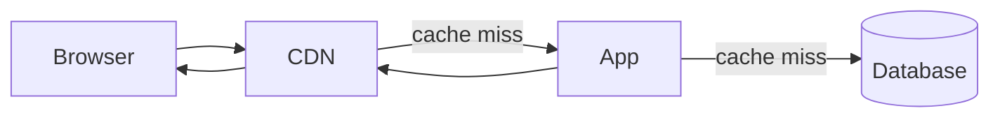

# Caching when the database, app server, and frontend are separate

Modern sites rarely serve every page straight from the database on every click. When **Postgres (or any DB)**, an **application server or API**, and a **CDN or static frontend** are separate services, caching is how you keep latency low and database load sane—at the cost of **temporary staleness** unless you design invalidation carefully.

This guide explains common patterns in plain language. It applies to any stack; the Nirvana Yoga School repo is mentioned briefly at the end.

---

## The request path (mental model)

A typical public page view might flow like this:



Each hop can cache—or not—depending on headers, auth, and configuration.

---

## Browser cache

The user’s browser stores responses (HTML, JSON, images, fonts) according to **`Cache-Control`**, **`ETag`**, and **`Last-Modified`**.

- **`max-age=3600`** — the browser may reuse the response for one hour without revalidating.
- **`private`** — only the browser may cache (typical for logged-in pages).
- **`no-store`** — do not cache at all (common for admin and auth).

Browsers also cache by URL; query strings and cookies affect behavior. For SPAs, API responses and static JS bundles are cached separately from HTML.

**Takeaway:** Even if your CDN and server are perfect, a aggressive browser cache can make *you* see old data while others see new—worth remembering when debugging.

---

## CDN / edge cache

A **CDN** (Cloudflare, Fastly, Vercel Edge, CloudFront, etc.) sits close to users and caches **HTTP responses**: HTML, JSON, images, CSS, JS.

Important directives:

| Header | Meaning |
|--------|---------|
| `public` | Shared caches may store the response |
| `private` | Shared caches must not store it |
| `s-maxage=N` | Shared cache TTL (CDN), often what you want for API JSON |
| `max-age=N` | Browser + shared cache TTL unless `s-maxage` overrides for shared caches |
| `stale-while-revalidate=N` | CDN may serve stale content while fetching fresh in the background |

Static assets (hashed filenames like `app.a1b2c3.js`) can use **long `max-age`** or **`immutable`** because the URL changes when content changes.

**HTML and JSON** usually need **shorter TTLs** or **explicit invalidation** when content is edited in a CMS.

---

## Application-level cache

The app server (Node, Go, Python, etc.) often keeps an **in-process or shared cache** between itself and the database:

- **In-memory** (per instance) — fast, lost on restart, inconsistent across many servers unless sticky routing is used.
- **Redis / Memcached** — shared across app instances; standard for sessions, rate limits, and hot query results.

### Cache-aside (lazy loading)

The most common pattern:

1. App checks cache for key `page:about`.
2. **Hit** → return cached value.
3. **Miss** → query DB, store in cache with TTL, return.

On **writes**, you either:

- **Delete** the cache key (next read repopulates), or
- **Update** the cache entry (harder when one write affects many keys).

Framework features like Next.js **`unstable_cache`** are essentially cache-aside with platform-managed storage and tag-based invalidation.

The same pattern appears everywhere; only the API names change. See [Framework examples](#application-cache-by-framework) below.

### What belongs here

Good candidates:

- Expensive read queries (joins, aggregations).
- Rarely changing configuration.
- Computed lists (e.g. “all published slugs”).

Poor candidates:

- Data that must be **strongly consistent** with writes (inventory, payments) unless invalidation is bulletproof.
- Large blobs better served from object storage + CDN.

---

## Application cache by framework

When the **database**, **app server**, and **CDN/frontend** are separate, the app tier almost always owns **cache-aside** for reads and **purge-on-write** (or TTL) for invalidation. Below are typical tools—not every app uses all of them.

| Framework / stack | Typical cache layer | Common APIs / patterns | Invalidation on CMS save |
|-------------------|--------------------|-------------------------|---------------------------|
| **Next.js** (App Router) | Platform Data Cache + Full Route Cache | `unstable_cache`, `fetch` + `revalidate`, `revalidateTag` / `revalidatePath` | Tag + path revalidation (see project doc) |
| **Django** | Redis/Memcached via cache framework | `cache.get/set`, `@cache_page`, low-level `cache.delete` | Signal handlers or `post_save` → delete keys or `cache.delete_many` |
| **Django ORM** | QuerySet cache (optional, e.g. django-cachalot) or manual | Per-view caching; ORM does not cache query results by default | Version keys or flush app cache namespace |
| **Laravel** | Redis (default in many deployments) | `Cache::remember('key', $ttl, fn)`, `Cache::tags(['pages'])->flush()` | Model observers / events → `Cache::forget` or tagged flush |
| **Ruby on Rails** | Redis or Memcached | `Rails.cache.fetch`, **Russian doll** fragment caching in views | `touch` associated records, `expire_fragment`, or `Rails.cache.delete` |
| **Express / Node** | Redis (`ioredis`, `node-cache` in-process) | Manual get/set; middleware for HTTP cache headers | Webhook from CMS or inline `redis.del` after DB commit |
| **Spring Boot** | Caffeine (in-JVM) or Redis | `@Cacheable`, `@CacheEvict`, `@CachePut` on service methods | `@CacheEvict` on repository save or domain events |
| **ASP.NET Core** | `IMemoryCache` or distributed Redis | `IDistributedCache`, response caching middleware | Remove keys by prefix or tag when entity changes |

**Django (deeper sketch):** Editors save a `Page` model → view or admin `save_model` runs → you `cache.delete(f"page:{slug}")` and optionally call your CDN purge API for `/about/`. **`@cache_page(3600)`** caches entire HTTP responses in the cache backend (similar spirit to CDN + short app cache, but stored in Redis unless you only use middleware). **`Vary: Cookie`** is required if any cached view might differ for logged-in users.

**Laravel (deeper sketch):** `Cache::remember("page:{$slug}", 3600, fn () => Page::with('modules')->find(...))` mirrors `unstable_cache`. **`Cache::tags`** map cleanly to CMS concepts (`page:foo`, `blog`) if the driver supports tags (Redis). **Horizon/queues** can defer CDN purges so the HTTP response to the editor stays fast.

**Rails (deeper sketch):** **Page caching** (write flat HTML to disk) is largely legacy; **fragment caching** (`<% cache @page do %>`) is still common for partials. **HTTP caching** via `fresh_when` / `stale?` uses **ETag** and **Last-Modified** against the DB row’s `updated_at`—excellent for APIs and conditional GETs without a Redis layer.

**Express (deeper sketch):** No built-in data cache—you compose Redis + `Cache-Control` on `res.setHeader`. Many teams put **nginx** or a CDN in front and cache GET JSON with `s-maxage`, while Node always checks Redis before Postgres.

**Spring (deeper sketch):** `@Cacheable("pages")` on a service method caches the returned DTO; eviction must be explicit on update or you rely on TTL. **Second-level cache** (Hibernate) is a different concern (entity-level, easy to get wrong across instances)—most CMS sites prefer Redis at the service layer.

---

## CDN in front of any backend

Whether the origin is Next on Vercel, Django on ECS, or Rails on Heroku, a **reverse proxy or CDN** (nginx, CloudFront, Fastly, Cloudflare, Akamai) sees the same HTTP semantics:

1. **Cacheable GET/HEAD** responses with `Cache-Control: public` and an **`s-maxage`** (or legacy `Expires`) can be stored at the edge.
2. **Purges** are vendor-specific (URL, prefix, tag) but the **contract** is always: origin must send correct headers and your CMS must trigger purge (or accept TTL staleness).
3. **Origin shield / stale-if-error** — some CDNs serve stale on 5xx; useful for resilience, confusing for editors if purge failed.

nginx example (conceptual): `proxy_cache` for `/api/public/*` with `proxy_cache_valid 200 1h`, while `/admin` is `proxy_no_cache 1` and passes **`Cookie`** through without storing responses.

**Takeaway:** The app must not assume “we cleared Redis” equals “users see new HTML.” You need a **layer map** (browser → CDN → app cache → DB) and invalidate every layer that might still serve old bytes—or bound staleness with TTL + SWR.

---

## HTTP caching headers (framework-agnostic)

Frameworks ultimately emit **HTTP responses**. Shared caches (CDN) and browsers obey the same core headers:

| Directive / header | Who respects it | Plain language |
|--------------------|-----------------|----------------|
| `Cache-Control: public` | CDN + browser (if not overridden) | Anyone may store a copy |
| `Cache-Control: private` | Browser only | CDN must not store (typical for sessions) |
| `Cache-Control: no-store` | Everyone | Do not persist; common for auth/admin |
| `s-maxage=N` | Shared caches (CDN) | Edge TTL; often **longer** than browser for APIs |
| `max-age=N` | Browser and shared cache | Default freshness for all caches unless `s-maxage` wins for shared |
| `stale-while-revalidate=N` | CDN (and some browsers) | Serve stale while fetching fresh in background |
| `ETag` / `If-None-Match` | Browser, CDN, origin | 304 Not Modified — save bandwidth, still a round trip |
| `Last-Modified` / `If-Modified-Since` | Same | Older conditional GET pattern |
| `Vary` | CDN | Cache key includes listed request headers (e.g. `Accept-Encoding`, `Accept-Language`) |

**Pattern for CMS JSON:** `public, s-maxage=3600, stale-while-revalidate=86400` (as in the Nirvana project’s `jsonCached`) — hot at the edge, bounded staleness, graceful revalidation under load.

**Pattern for admin:** `private, no-store` or `private, max-age=0, must-revalidate` so shared caches never reuse a response tied to **`Authorization`** or session cookies.

---

## GraphQL vs REST caching

- **REST** maps URLs to resources — CDNs cache **GET /api/pages/about** naturally if headers allow.
- **GraphQL** often uses **POST /** with the query in the body — **not CDN-cacheable by default**. Mitigations: persisted queries (GET with hash), separate **CDN-friendly REST** for public read models, or `@cacheControl` directives on the schema (Apollo) with a CDN that understands them.
- **Field-level** GraphQL caches (server-side) resemble app Redis caches; **HTTP edge** caching still needs a stable URL or explicit CDN rules.

For a marketing CMS, teams often expose **read-only REST or JSON** for public content and keep GraphQL for admin or app internals.

---

## Sessions, auth, and why admin bypasses cache

Any route that depends on **who is logged in** must not be stored in a **shared** cache:

- Session cookies (`Set-Cookie`, `Cookie`) make responses **user-specific**.
- CDNs default to **not** caching responses with `Set-Cookie` or with `Cache-Control: private`.
- **`Vary: Cookie`** is fragile at scale (cache fragmentation); better to mark admin/API auth as **`no-store`** and route admin on a path prefix with bypass rules.

This applies in **every** stack: Django `@login_required` views, Laravel `auth` middleware, Rails `before_action :authenticate_admin!`, Express session middleware, Spring Security filters. Public marketing HTML stays cacheable; **admin consoles** stay dynamic.

Client-side SPAs often use **`fetch(..., { cache: 'no-store' })`** for `/api/auth/me` even when the HTML shell is static—same idea as server-side dynamic rendering in Next when `cookies()` is read.

---

## Database query cache

Some databases or ORMs offer query result caching. **Postgres itself** does not cache query results across transactions the way application caches do; it caches **pages in shared buffers** (transparent to you).

Practical rule: treat **Postgres as authoritative** and put repeatable read caching **in the app or CDN layer** where you control TTL and invalidation.

Connection poolers (PgBouncer, Neon pooler) reuse connections—they are not a substitute for a content cache.

---

## Invalidation strategies

### Time-based (TTL)

Every entry expires after **N seconds**. Simple and robust; worst-case staleness is **N**.

Use when:

- Slight delay is acceptable (marketing copy, blog posts with hourly refresh).
- You want protection if invalidation events are missed.

### Event-driven

On **create/update/delete**, the app (or a worker) **purges or updates** cache keys—often via:

- Explicit API (`PURGE /cache/tag/page:foo`).
- Pub/sub (Redis, SNS) telling all nodes to drop keys.
- CDN purge APIs (invalidate `/blog/*`).

Use when:

- Editors expect **immediate** public updates after publish.
- Stale content has legal or revenue impact.

### Hybrid (common in production)

- **TTL** as a safety net (e.g. 1 hour).
- **Event-driven purge** on CMS save for the affected slugs/paths.
- **`stale-while-revalidate`** at CDN for smooth traffic spikes.

---

## Stale-while-revalidate (SWR)

**SWR** at the CDN or framework level means: “If the entry is past its fresh time but within the SWR window, serve the old copy **and** refresh asynchronously.”

Users get fast responses; editors may briefly still see old content at the edge until refresh completes. Pair SWR with **on-demand invalidation** when immediate correctness matters.

Example HTTP shape (as used on this project’s public JSON APIs):

```http
Cache-Control: public, s-maxage=3600, stale-while-revalidate=86400
```

Fresh at the edge for 1 hour; stale may still be served for up to 24 hours while revalidating.

---

## Consistency tradeoffs

| Strategy | Latency | DB load | Staleness risk |
|----------|---------|---------|----------------|
| No cache | Highest | Highest | None |
| TTL only | Low | Low | Up to TTL |
| Event purge + TTL | Low | Low | Low if purge is correct |
| CDN SWR | Very low | Low | Can be noticeable without purge |

**Strong consistency** across DB, app cache, CDN, and browser is expensive; most marketing sites choose **eventual consistency** with bounded TTL.

---

## What NOT to cache (or cache carefully)

- **Authenticated admin** — session cookies make responses user-specific; use **`private, no-store`** or no cache.
- **Personalized pages** — cart, account, A/B tests tied to cookies.
- **Secrets and tokens** — never in shared caches.
- **POST/PUT/DELETE responses** — generally non-cacheable.
- **Third-party CDNs you don’t control** — e.g. image host URLs may stay cached after you change metadata in your DB.

Always vary or bypass cache when **`Authorization`** or sensitive cookies are present.

---

## Typical HTTP headers (cheat sheet)

| Header | Role |
|--------|------|
| `Cache-Control` | Primary freshness rules |
| `ETag` / `If-None-Match` | Conditional GET; 304 Not Modified saves bandwidth |
| `Last-Modified` / `If-Modified-Since` | Older conditional pattern |
| `Vary` | Tells caches which request headers affect the response (e.g. `Accept-Encoding`) |

For APIs consumed by browsers **and** CDNs, teams often set **`s-maxage`** for the CDN and **`max-age=0`** or short browser cache so clients revalidate more often while the edge stays hot.

---

## Putting it together: a CMS-backed marketing site

1. **Editor saves** → write to Postgres → emit invalidation (tags, paths, CDN purge).
2. **Next visitor** → CDN miss or stale → app loads data (app cache miss → DB) → render → cache at CDN with TTL + SWR.
3. **Static assets** → long-lived on CDN; **HTML/JSON** → short TTL + purge on publish.

Failure mode to avoid: **only** clearing an application data cache while **HTML at the CDN** still shows old content. Full-stack frameworks solve this with both **data tag revalidation** and **route/path revalidation**—see the project-specific doc.

---

## How Nirvana Yoga School maps to this

This repo is **Next.js 16 + Vercel + Neon Postgres**—one instance of the split-stack model above. Layer mapping:

| Generic layer | Here |
|---------------|------|
| Database | Neon Postgres |
| App read cache | `unstable_cache` + tagged invalidation |
| Edge / CDN | Vercel Full Route Cache + `jsonCached` API headers |
| Media CDN | Cloudinary (outside app control) |
| Admin | Session cookies → dynamic, no public edge cache |

**TTLs, tags, save flows, and every Next.js caching API used (or not) in this codebase** are documented in **`docs/caching-in-this-project.md`** — use that file as the source of truth for this project.
